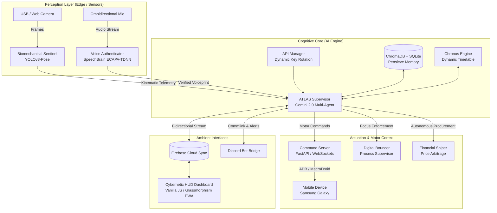

<div align="center">

# 🏛️ PROJECT ATLAS (v1.0)
### Autonomous Personal Command Center & Cybernetic Chief of Staff
**Engineered by [Mukul A.](https://github.com/Mukula2704)**

[](https://www.python.org/)
[](https://ai.google.dev/)
[](https://pytorch.org/)
[](https://fastapi.tiangolo.com/)
[](https://firebase.google.com/)
[](LICENSE)

<br/>

> *"Not a chat widget. An ambient, proactive executive operating system that perceives physical posture, authenticates acoustic biometrics, manages personal finance, and controls physical devices."*

</div>

---

### 📋 RECRUITER & EVALUATOR NOTICE
> [!NOTE]
> This repository is maintained publicly as an engineering portfolio showcase for technical recruiters, hiring teams, and engineering evaluators.
> **All intellectual property rights are reserved.** While you are warmly invited to inspect, review, and evaluate the architecture and implementation for hiring and assessment purposes, copying, unauthorized duplication, commercial usage, and derivative works are strictly prohibited under the terms of the [LICENSE](LICENSE).

---

## 🧭 System Overview

**Project ATLAS** is an end-to-end autonomous personal operating system designed to eliminate executive friction. Rather than relying on passive prompt-response loops, ATLAS acts as an assertive **Chief of Staff** capable of:
1. **Multi-Modal Perception:** Real-time posture tracking through edge computer vision and acoustic voiceprint authentication.
2. **Decentralized Cognitive Core:** Multi-agent supervisor orchestrating memory retrieval, daily schedules, and autonomous tool calling with automated multi-key API failovers.
3. **Physical Actuation (Motor Cortex):** Direct remote control over mobile devices and operating system focus environments.
4. **Ambient Cybernetic HUD:** High-performance, zero-latency glassmorphic web interface with bidirectional real-time telemetry streaming via Firebase.

---

## 🏛️ System Architecture



---

## ⚡ Core Subsystems & Engineering Highlights

### 1. 🧠 Autonomous Cognitive Core (`AtlasSupervisor` & `ATLAS_MANIFESTO`)
* **Assertive Directive:** Adheres to a strict anti-hallucination, anti-sycophancy instruction set. If user decisions diverge from long-term goals or health parameters, ATLAS proactively intervenes.
* **Resilient API Management (`api_manager.py`):** High-availability multi-key rotation mechanism with automatic exponential backoff and seamless failover across multiple Gemini API endpoints.
* **Long-Term Episodic & Semantic Memory (`brain_db.py`):** Dual-tier architecture using ChromaDB vector embeddings for contextual memory search combined with SQLite for transactional pensieve records.

### 2. 👁️ Biomechanical Sentinel (`biomechanical_sentinel.py`)
* Leverages **YOLOv8-pose** to extract 17 key skeletal landmark coordinates in real-time.
* Calculates cervical angle and shoulder alignment ratios to detect forward head posture, slumping, and prolonged sedentary states, pushing corrective feedback to the ambient HUD.

### 3. 🎙️ Acoustic Biometric Verification (`verify_voice.py`)
* Implements deep acoustic speaker recognition using **SpeechBrain's ECAPA-TDNN** model trained on VoxCeleb.
* Extracts 192-dimensional speaker embeddings and computes cosine distance against enrolled baseline voiceprints (`baseline_mukul.wav`), rejecting unauthorized acoustic inputs.

### 4. ⏳ Chronos Engine & Biorhythm DJ (`chronos_engine.py`, `biorhythm_dj.py`)
* Dynamically adjusts time blocks based on cognitive fatigue, hydration logs, and daily productivity progress.
* Integrates with Spotify Web API to synchronize background binaural beats or high-tempo focus tracks conditioned on the current active task state.

### 5. 🛡️ Digital Bouncer (`digital_bouncer.py` / `windows_bouncer.py`)
* Monitors running processes in real-time. Automatically restricts distracting social media and gaming applications during scheduled deep-work blocks, ensuring ruthless task adherence.

### 6. 📱 Physical Motor Cortex & Procurement Protocol (`command_server.py`, `financial_sniper.py`)
* Translates high-level LLM intentions into structured motor directives (`[MOTOR_COMMAND: action: details]`).
* Interfaces with Android devices for automated execution (alarms, smart switches, stage payment flows) with strict human-in-the-loop Discord confirmation triggers.

### 7. 💻 Ambient Cybernetic HUD (`public/`)
* Built with pure, high-efficiency **Vanilla JavaScript and CSS Glassmorphism** (zero bloated frameworks).
* Service Worker enabled Progressive Web App (PWA) with offline capabilities.
* Live terminal log stream (`NEURAL LINK`), dynamic day progress gauge, automated workout logger, and integrated AI masterclass curriculum.

---

## 🛠️ Technology Stack

| Layer | Technologies |
|---|---|
| **Cognitive Core & Reasoning** | Python 3.11, Google GenAI SDK (Gemini 2.0 / Flash), Multi-Agent Architecture |
| **Vision & Kinematics** | PyTorch, Ultralytics YOLOv8-pose, OpenCV |
| **Audio & Biometrics** | SpeechBrain (ECAPA-TDNN), Torchaudio, SoundDevice |
| **Storage & Memory** | ChromaDB (Vector Store), SQLite (Pensieve DB), Firebase Firestore |
| **Networking & APIs** | FastAPI, Uvicorn, WebSockets, Discord.py, Spotipy |
| **Frontend HUD** | Vanilla JavaScript, Modern CSS3 Glassmorphism, Service Workers (PWA) |

---

## 📂 Repository Layout

```text
comand-center/
├── ai-core/                        # Python Edge Microservices & Cognitive Core
│   ├── atlas_core.py               # Main runtime orchestrator
│   ├── supervisor.py               # Cognitive supervisor agent
│   ├── ATLAS_MANIFESTO.md          # Core non-sycophantic system instructions
│   ├── api_manager.py              # Multi-key failover & rate-limit manager
│   ├── biomechanical_sentinel.py   # YOLOv8 posture & ergonomics analyzer
│   ├── verify_voice.py             # ECAPA-TDNN biometric speaker verification
│   ├── brain_db.py                 # ChromaDB vector memory & SQLite pensieve
│   ├── chronos_engine.py           # Adaptive timetable scheduling engine
│   ├── command_server.py           # FastAPI Motor Cortex endpoint for Android
│   ├── biorhythm_dj.py             # Spotify contextual audio controller
│   ├── digital_bouncer.py          # Active distraction & process blocker
│   ├── financial_sniper.py         # Autonomous procurement & budget auditor
│   ├── discord_commlink.py         # Mobile Discord notification & command bridge
│   ├── .env.example                # Safe environment variable configuration template
│   └── requirements.txt            # Python dependencies
│
├── public/                         # Ambient Cybernetic Web HUD (Frontend)
│   ├── index.html                  # Main Command Center HUD
│   ├── atlas_holy_grail.html       # Specialized high-density telemetry interface
│   ├── atlas_dashboard.css         # Glassmorphism cybernetic design system
│   ├── sw.js                       # PWA Service Worker for offline resilience
│   └── docs/                       # Technical architecture & subsystem documentation
│
├── functions/                      # Firebase Cloud Functions backend triggers
├── Mukul_A_Resume.md               # Author professional credentials & engineering background
├── Mukul_A_Web_Resume.html         # Interactive web portfolio
├── LICENSE                         # Proprietary Source-Available Portfolio License
└── README.md                       # Comprehensive system documentation
```

---

## 🚀 Quickstart & Setup (For Technical Evaluators)

### 1. Prerequisites
* Python 3.10+ (Python 3.11 recommended)
* Node.js 18+ (for Firebase Functions & web tooling)
* A modern browser (Chrome / Edge / Firefox)

### 2. Environment Configuration
```bash
# Clone the repository
git clone https://github.com/Mukula2704/Atlas-verion-1-.git
cd Atlas-verion-1-/ai-core

# Setup virtual environment
python -m venv venv
# On Windows:
.\venv\Scripts\activate
# On Linux/macOS:
source venv/bin/activate

# Install dependencies
pip install -r requirements.txt

# Configure environment variables
cp .env.example .env
# Open .env and insert your API keys (Gemini, Spotify, Discord)
```

### 3. Launching the System
```bash
# Start the ATLAS Supervisor & Microservice mesh
python atlas_core.py

# In a separate terminal, launch the ambient Web HUD:
cd ../public
python -m http.server 5000
# Navigate to http://localhost:5000 in your browser
```

---

## 👤 Author & Contact

**Mukul A.**
* **GitHub:** [@Mukula2704](https://github.com/Mukula2704)
* **LinkedIn:** [linkedin.com/in/mukul-a-815248302](https://www.linkedin.com/in/mukul-a-815248302)
* **Portfolio Resume:** [Mukul_A_Resume.md](Mukul_A_Resume.md)

---

<div align="center">
<sub>Built with precision. Project ATLAS Version 1.0 © 2026 Mukul A. All Rights Reserved.</sub>
</div>
